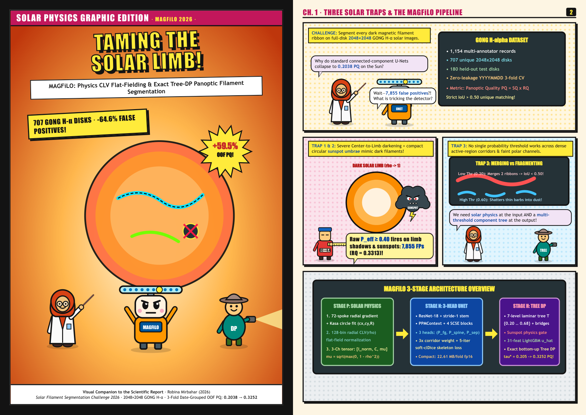
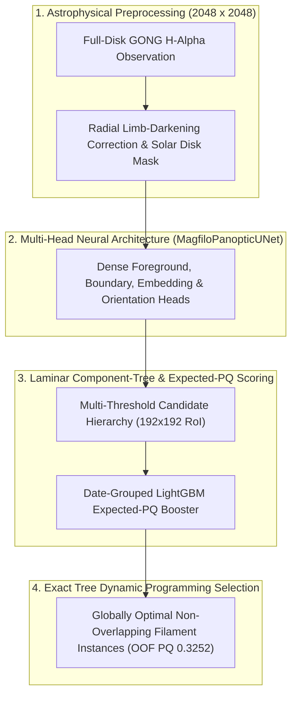
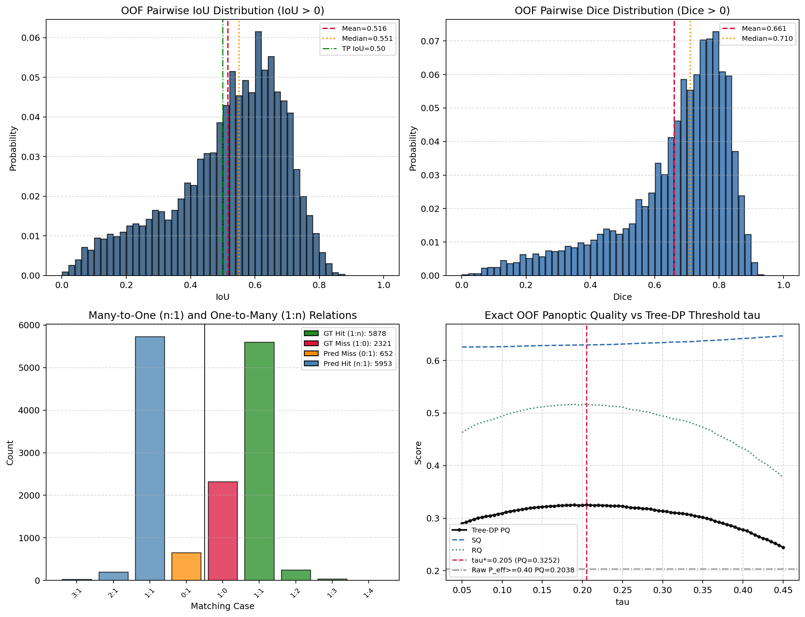
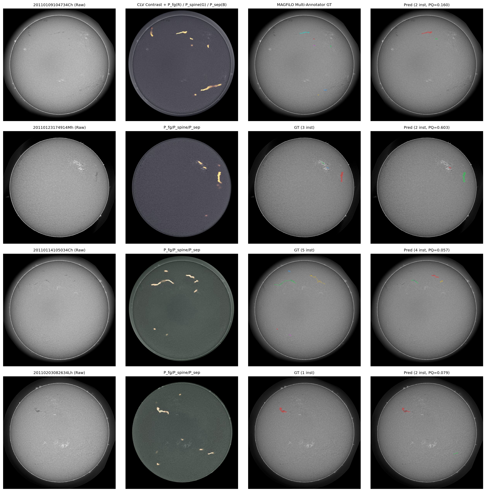

# MAGFiLO Panoptic Solar Filament Segmentation

[](LICENSE)
[](requirements.txt)
[](requirements.txt)
[](https://www.kaggle.com/competitions/filament-segmentation-2026)

**Author:** Robina Mirbahar ([@robinamirbahar](https://www.kaggle.com/robinamirbahar))  
**Selected Final Kaggle Submission:** `submission_pq_optimal.csv` (Ref `58343725`, Public LB PQ `0.30`, 3-Fold Date-Grouped OOF PQ `0.3252`)

End-to-end modular Python & PyTorch repository implementing a three-stage astrophysical preprocessing, topology-aware multi-head U-Net (`MagfiloPanopticUNet`), and laminar component-tree dynamic programming pipeline for full-disk GONG H-alpha (`2048 x 2048`) solar filament panoptic segmentation (**Solar Filament Segmentation Challenge 2026**).

All trained neural fold checkpoints (`float16`, `22.61 MB` each) and date-grouped LightGBM expected-PQ boosters are stored directly in [`./weights/`](weights/) so the judging committee can reproduce every test prediction via [`pipeline.ipynb`](pipeline.ipynb) or `train_magfilo_panoptic.py --predict-only` **without retraining**.

### Scientific Report, Visual Graphic Guide & 1080p Explainer Video (`./docs/`)
* **[`01_Scientific_Paper_MAGFiLO_Solar_Filament_2026.pdf`](docs/01_Scientific_Paper_MAGFiLO_Solar_Filament_2026.pdf)** — Formal 4-Page Scientific Report (LaTeX/IEEE format).
* **[`02_Visual_Comic_Guide_MAGFiLO_Solar_Filament_2026.pdf`](docs/02_Visual_Comic_Guide_MAGFiLO_Solar_Filament_2026.pdf)** — Illustrated 4-Page A4 Vector Graphic-Story Companion.
* **[`03_Explainer_Video_MAGFiLO_Solar_Filament_1080p.mp4`](docs/03_Explainer_Video_MAGFiLO_Solar_Filament_1080p.mp4)** + **[`04_Video_Narration_Guide.md`](docs/04_Video_Narration_Guide.md)** — 1920x1080 H.264 Tree-DP Telemetry Sweep Video & Voice-Over Script.



> **Author & Architect:** [Robina Mirbahar](https://github.com/RobinaMirbahar) ([Google Developer Expert in Cloud & AI](https://developers.google.com/profile/u/106918534005910641104?utm_campaign=deveco_gdemembers&utm_source=deveco) · Google Cloud Champion Innovator · Co-Author of [*AI Engineering*](https://www.amazon.com/dp/B0GWCZWCF4))  
> 📚 **Competition & Paper:** [NSF / NSO Solar Filament Segmentation Challenge 2026](https://www.kaggle.com/competitions/filament-segmentation-2026) · [4-Page IEEE Paper PDF](docs/01_Scientific_Paper_MAGFiLO_Solar_Filament_2026.pdf) · [Vector Graphic Story PDF](docs/02_Visual_Comic_Guide_MAGFiLO_Solar_Filament_2026.pdf)  
> **Core Stack:** PyTorch (MagfiloPanopticUNet), Limb-Corrected GONG H-Alpha Physics (2048x2048), Laminar Component-Tree Dynamic Programming, and LightGBM Expected-PQ Boosters.

---
## Quick Start: Zero-Retrain Reproduction

```bash
# 1. Install pinned/compatible dependencies
pip install -r requirements.txt

# 2. Smoke-test stored weights end-to-end without retraining (synthetic 2048x2048 solar disks)
python train_magfilo_panoptic.py \
  --predict-only \
  --weights-dir ./weights \
  --dry-run \
  --out-dir ./dry_run_out

# 3. Reproduce exact Kaggle test submission (submission_pq_optimal.csv, ref 58343725) on the 180 test disks
python train_magfilo_panoptic.py \
  --predict-only \
  --weights-dir ./weights \
  --data-root /path/to/MAGFiLO_1.0_Kaggle_2026 \
  --out-dir ./predictions

# 4. Interactive pipeline walkthrough (loads ./weights/, verifies inference, and renders OOF diagnostics)
jupyter notebook pipeline.ipynb
```

To retrain all 3 observation-date-grouped folds, OOF LightGBM calibrators, and test predictions from scratch (`~3.3 hours` on 1x NVIDIA Tesla T4 GPU):

```bash
python train_magfilo_panoptic.py \
  --data-root /path/to/MAGFiLO_1.0_Kaggle_2026 \
  --out-dir ./out
```


### 📐 Astrophysical & Tree-DP Panoptic Pipeline


---

## Three-Stage Pipeline Architecture

1. **Stage 0: Zero-Leakage Date-Grouped Cross-Validation (`train_magfilo_panoptic.py`)**
   * Groups multi-annotator records across `707` unique physical solar disks by `YYYYMMDD` observation date into 3 disjoint CV folds so consecutive multi-station GONG captures never straddle train and validation splits.
   * Synthesizes soft consensus foreground (`y_fg in [0, 1]`), spine centerline (`y_spine` combining explicit MAGFiLO `annotation["spine"]` polylines and medial-axis skeletons), and same-annotator `1-8 px` inter-filament separation corridors (`y_sep in {0, 1}`).

2. **Stage P: Astrophysical Limb & Chromospheric Contrast Normalization (`src/magfilo_panoptic/preprocessing.py`)**
   * Regresses solar disk geometry `(cx, cy, R)` via 72-ray 50%-limb crossing and Kasa circle fit, computes 128-bin radial median Center-to-Limb Variation (`norm_CLV`), masks off-limb pixels (`r > 0.995 R`), estimates normalized-convolution local absorption contrast `(B_sigma48 - F) / B_sigma48`, and appends heliocentric cosine `mu = sqrt(max(0, 1 - (r/R)^2))`.

3. **Stage N: Topology-Aware 3-Head Network (`src/magfilo_panoptic/network.py`)**
   * `MagfiloPanopticUNet` (`resnet18` encoder, stride-1 full-resolution stem, Pyramid Pooling Module bottleneck, scSE spatial-channel attention decoder) jointly predicting `(P_fg, P_spine, P_sep)` at `1536 x 1536` tight disk crop resolution.
   * Trained with boundary-upweighted `BCE + SoftDice` (`3x` pixel weight inside `y_sep` corridors) plus `0.25 * soft_clDice` centerline topology preservation (Shit et al., *CVPR* 2021).

4. **Stage H: Laminar Component Tree & Exact Bottom-Up Tree-DP (`src/magfilo_panoptic/postprocessing.py`)**
   * Forms effective probability `P_eff = clip(0.75 P_fg + 0.25 P_spine - 0.35 P_sep, 0, 1)`, extracts a 7-superlevel laminar component tree (`area >= 120 px`), rejects compact low-aspect umbral sunspots, scores each candidate's expected PQ contribution `u_hat(c)` over 31 geometric/photometric features via 3-fold LightGBM, and solves exact bottom-up Tree-DP over pairwise-disjoint antichains maximizing `sum(u_hat(c) - tau*)` (`tau* = 0.205`).

---

## Quantitative & Qualitative Evaluation

Measured 3-fold date-grouped out-of-fold (OOF) validation across `707` unique GONG H-alpha solar disks (`1,154` multi-annotator records, 4-view dihedral TTA):

| Operating Point | 3-Fold OOF PQ | SQ | RQ | TP / FP / FN | IoU (mean / p50) | Dice (mean / p50) | Public LB PQ |
| :--- | :---: | :---: | :---: | :---: | :---: | :---: | :---: |
| Raw `P_eff >= 0.40` Connected Components | `0.2038` | `0.6152` | `0.3313` | `3187 / 7855 / 5012` | `0.4330 / 0.4453` | `0.5801 / 0.6162` | -- |
| Tree-DP High-Precision (`tau = 0.240`) | `0.3231` | `0.6306` | `0.5124` | `3647 / 2390 / 4552` | `0.5210 / 0.5561` | `0.6655 / 0.7147` | -- |
| **Tree-DP PQ-Optimal (`tau* = 0.205`, Selected)** | **`0.3252`** | **`0.6295`** | **`0.5166`** | **`3824 / 2782 / 4375`** | **`0.5163 / 0.5508`** | **`0.6611 / 0.7104`** | **`0.30` (ref `58343725`)** |
| Tree-DP + Spine-Tangent Bridging (`gap <= 14 px`) | `0.3252` | `0.6295` | `0.5166` | `3824 / 2782 / 4375` | `0.5163 / 0.5508` | `0.6611 / 0.7104` | -- |

* **Gain over raw connected-components baseline:** `+0.1214` absolute PQ (`+59.6%` relative) with `-64.6%` fewer false positives (`7,855 -> 2,782`).
* **OOF quartiles (`pq_optimal`):** IoU `p25 / p50 / p75 = 0.4181 / 0.5508 / 0.6471`; Dice `p25 / p50 / p75 = 0.5896 / 0.7104 / 0.7858`.
* **Multiplicity control (`pq_optimal`):** GT matching degrees `{0: 2321, 1: 5597, 2: 247, 3: 33, 4: 1}` (`281` `1:n` splits); predicted matching degrees `{0: 652, 1: 5734, 2: 197, 3: 22}` (`219` `n:1` merges).

### OOF Quantitative Rubric Distributions


### Qualitative Validation Disks (Raw H-alpha, CLV + 3-Head RGB, MAGFiLO GT & Tree-DP)


---

## Repository Structure

```text
magfilo-panoptic-seg/
├── .gitattributes             # Enforces LF line endings on LightGBM .txt boosters across OSes
├── .gitignore
├── LICENSE                    # MIT Open-Source License (Robina Mirbahar)
├── README.md
├── pipeline.ipynb             # Executed GDE Material-3 pipeline & zero-retrain verification notebook
├── requirements.txt           # Explicit package versions for reproduction
├── train_magfilo_panoptic.py  # Full 3-fold training, OOF calibration & --predict-only CLI
├── assets/
│   ├── qualitative_morphology_panels.png
│   ├── quantitative_rubric_histograms.png
│   └── run_metrics.json       # Verified 3-fold OOF metrics dictionary
├── src/
│   └── magfilo_panoptic/
│       ├── __init__.py
│       ├── metrics.py         # Exact multi-annotator PQ, SQ, RQ, IoU/Dice & 1:n / n:1 evaluator
│       ├── network.py         # MagfiloPanopticUNet, SolarMultiTaskLoss, soft-clDice & TTA inference
│       ├── postprocessing.py  # 7-level component tree, LightGBM u_hat scorer, Tree-DP & bridging
│       ├── preprocessing.py   # 72-ray Kasa disk fit, 128-bin CLV flat-fielding, contrast & mu
│       └── rle.py             # Fortran-order 2048x2048 COCO RLE encoder/decoder
└── weights/
    ├── lgb_scorer.txt         # Full-OOF LightGBM expected-PQ booster
    ├── lgb_scorer_fold0.txt   # Fold-0 LightGBM expected-PQ booster
    ├── lgb_scorer_fold1.txt   # Fold-1 LightGBM expected-PQ booster
    ├── lgb_scorer_fold2.txt   # Fold-2 LightGBM expected-PQ booster
    ├── postproc_config.json   # Calibrated thresholds (tau_optimal=0.205) & inference metadata
    ├── unet_fold0_fp16.pt     # Fold-0 MagfiloPanopticUNet FP16 checkpoint (22.61 MB)
    ├── unet_fold1_fp16.pt     # Fold-1 MagfiloPanopticUNet FP16 checkpoint (22.61 MB)
    └── unet_fold2_fp16.pt     # Fold-2 MagfiloPanopticUNet FP16 checkpoint (22.61 MB)
```

---

## References & Acknowledgment

1. A. Ahmadzadeh et al., *"A dataset of manually annotated filaments from H-alpha observations"*, *Nature Scientific Data*, vol. 11, art. 1031, 2024, doi:[10.1038/s41597-024-03876-y](https://doi.org/10.1038/s41597-024-03876-y).
2. A. Ahmadzadeh, D. J. Kempton, Q. Li, and A. A. Pevtsov, *"Solar Filament Segmentation Challenge 2026"*, Kaggle, 2026, [https://www.kaggle.com/competitions/filament-segmentation-2026](https://www.kaggle.com/competitions/filament-segmentation-2026).
3. S. Shit et al., *"clDice - a Novel Topology-Preserving Loss Function for Tubular Structure Segmentation"*, *IEEE/CVF CVPR*, 2021.
4. A. Kirillov et al., *"Panoptic Segmentation"*, *IEEE/CVF CVPR*, 2019.

This work utilizes GONG data obtained by the NSO Integrated Synoptic Program, managed by the National Solar Observatory, which is operated by the Association of Universities for Research in Astronomy (AURA), Inc. under a cooperative agreement with the National Science Foundation and with contribution from the National Oceanic and Atmospheric Administration. The GONG network of instruments is hosted by the Big Bear Solar Observatory, High Altitude Observatory, Learmonth Solar Observatory, Udaipur Solar Observatory, Instituto de Astrofísica de Canarias, and Cerro Tololo Interamerican Observatory.

The organization of the Filament Segmentation Challenge 2026 is partially supported by the U.S. National Science Foundation (NSF) under Grant No. 2209912 and 2433781, directorate for Computer and Information Science and Engineering (CSE), and Office of Advanced Cyberinfrastructure (OAC), and Grant No. 2511630, AST Division Of Astronomical Sciences and MPS Directorate for Mathematical and Physical Sciences, and sponsored by the U.S. National Science Foundation (NSF) National Solar Observatory (NSO).
